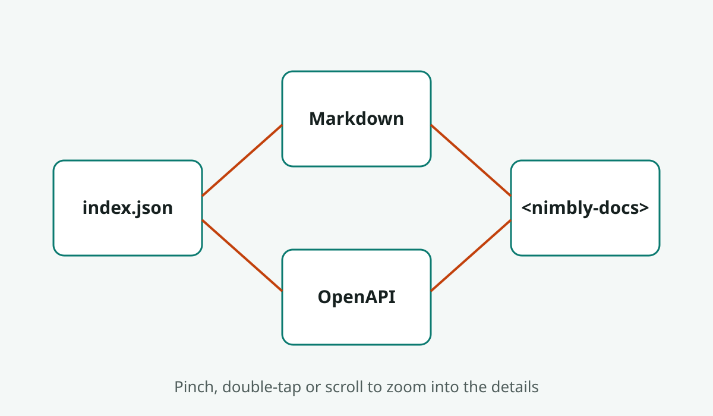
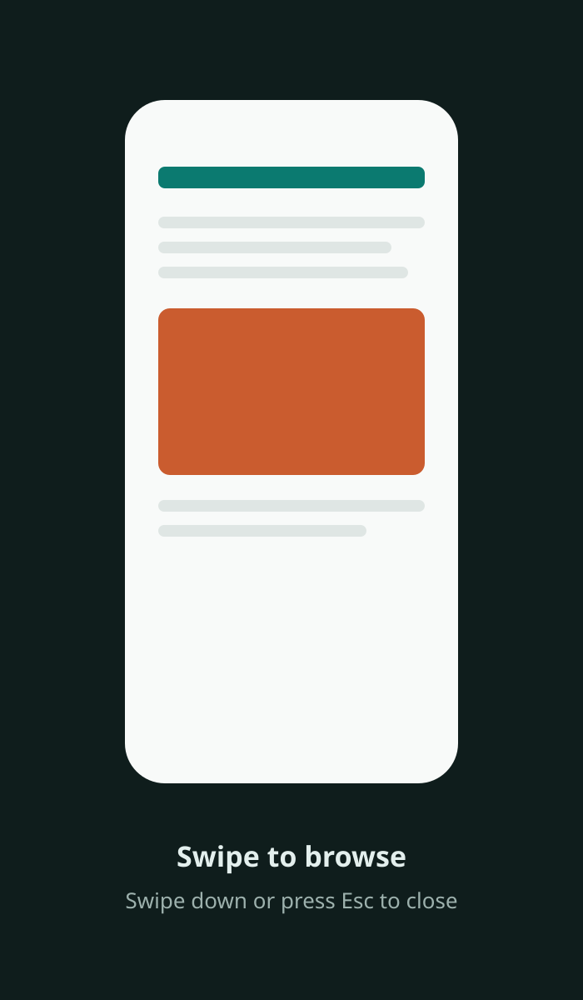

# API reference and image viewer

Nimbly Docs can show an **OpenAPI 3.x** or **Swagger 2.0** description (JSON or
YAML, local or remote) as a regular documentation page. It is read-only: there
is no "try it out" and the viewer never calls your API.

## Try it

- **API reference** at the bottom of the sidebar opens [the Petstore sample](../specs/petstore.yaml), an OpenAPI 3 YAML file.
- **Sample services → Orders API** renders a Swagger 2.0 JSON file with the same viewer.
- **Sample services → Swagger Petstore** is a plain external link.

Operations are grouped by tag. Open one to see its parameters, request body,
responses, schemas and a generated example. Type in the filter to narrow long
APIs; type names link to their schema.

## Add an API to the sidebar

Use `api` instead of `source` on any page. This works at any navigation depth,
so every application branch can carry its own API:

```json title="index.json"
{
  "id": "billing",
  "title": "Billing",
  "sections": [{
    "id": "billing-service",
    "title": "Billing service",
    "pages": [
      { "id": "billing-guide", "title": "Guide", "source": "billing.md" },
      { "id": "billing-api", "title": "API", "api": "./specs/billing.yaml" },
      { "id": "billing-console", "title": "Console", "link": "https://billing.example.com/swagger" }
    ]
  }]
}
```

| Field | Effect |
| --- | --- |
| `api` | Renders the OpenAPI/Swagger file inside the docs. Relative to the manifest, or an https URL (the server must allow CORS). May be a `{ "locale": "path" }` map. |
| `link` | The entry opens an external page in a new tab. It is not routed, searched or listed in previous/next. |

The pinned sidebar link works the same way: `apiReference.spec` renders the file
inside the docs, while `apiReference.url` keeps an external link.

```json
"apiReference": { "spec": "./specs/petstore.yaml", "label": "API reference" }
```

Operations can be linked like headings, for example
[Create a pet](../specs/petstore.yaml#op-createpet) (link to the spec file plus the operation id). With `features.sourceDownload`, the
description file is offered under **Downloads**.

## Image viewer

Images and diagrams open in a full-screen viewer instead of a new page.



[](../assets/gallery-mobile.svg)

| Action | Mouse and keyboard | Touch |
| --- | --- | --- |
| Next / previous | Arrows, `←` `→` | Swipe sideways |
| Zoom | Wheel, `+` `−` `0`, double-click | Pinch, double-tap |
| Pan | Drag when zoomed | Drag when zoomed |
| Close | `Esc`, click outside | Swipe down, tap outside |

Links to image files (`.png`, `.jpg`, `.svg`, `.webp`, …) open in the viewer
too, so a small preview can link to a large original. Cmd/Ctrl-click still opens
a new tab. Turn the viewer off with `"features": { "lightbox": false }`.
