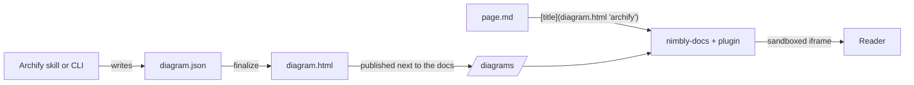

# Archify diagrams :badge[plugin]

[Archify](https://github.com/tt-a1i/archify) turns a short JSON description into an interactive diagram: architecture maps, sequences, workflows, database schemas and more. Each diagram is **one standalone HTML file**, validated before it is delivered. This optional plugin shows those files inside a Nimbly page, in a sandboxed frame that follows the page theme.

Both diagrams below are generated from JSON files in this repository and embedded with one Markdown line each. Click a node to highlight what it connects to. **Expand** opens the full Archify viewer on the whole window, with search, route tracing and export.

[How the viewer is built](../diagrams/nimbly-architecture.html "archify ratio=967:1046")

[What happens when a page opens](../diagrams/nimbly-page-load.html "archify ratio=1085:603")

:::note Why a plugin and not a feature?
A diagram file contains a script, and Nimbly never runs code that comes from content. Instead of loosening the sanitizer, the plugin does one narrow thing: it frames a file you published yourself, in an isolated sandbox. It is a separate ~2 KB file. The core bundle does not change and does not import it.
:::

## How it fits together



The Markdown only holds a link. Without the plugin, or on a host that has not opted in, it stays an ordinary link to the file, so the same pages work in any Markdown reader and on GitHub.

## Quick start

:::steps
1. **Put the plugin next to the bundle.** Copy `archify-embed.<version>.min.js` from the [release](https://github.com/asterd/nimbly-docs/releases) (or `https://asterd.github.io/nimbly-docs/cdn/archify-embed.latest.min.js`).
2. **Load it and opt in.** Add one `<script>` and one attribute to the host page.
3. **Publish diagrams** as HTML files in a single folder, for example `diagrams/`.
4. **Link them** from Markdown with the title `archify`.
:::

:::code-group
```html title="index.html"
<script type="module" src="./assets/nimbly-docs.min.js"></script>
<script type="module" src="./assets/archify-embed.min.js"></script>

<nimbly-docs manifest="./index.json" archify-base="./diagrams/"></nimbly-docs>
```
```md title="pages/architecture.md"
## Architecture

[Runtime architecture](../diagrams/app-architecture.html "archify ratio=1080:640")
```
```bash title="scaffold"
# a new project that is already wired for diagrams
npx nimbly-docs-init my-docs --title "My docs" --archify
```
:::

Pin the files with Subresource Integrity when they come from a CDN: every release publishes a `.sha384` next to the plugin.

```html
<script type="module"
  src="https://asterd.github.io/nimbly-docs/cdn/archify-embed.0.0.10.min.js"
  integrity="sha384-…"
  crossorigin="anonymous"></script>
```

### The link title

Everything after the word `archify` is an option. Unknown options are ignored.

| Title | Effect |
| --- | --- |
| `"archify"` | Frame 560 px tall |
| `"archify ratio=1080:640"` | The frame keeps the diagram's proportions at any column width (capped at 90% of the window height) |
| `"archify height=720"` | Fixed height in px, from 240 to 1600 |

The link text becomes the frame title and its accessible name. A link is upgraded only when it points to a **same-origin `.html` file inside `archify-base`**. Anything else stays a link.

To get `ratio` right, read the canvas size from the file. This one-liner prints it (the constant adds the small margin the viewer keeps around the drawing):

```bash
node -e 'const s=require("fs").readFileSync(process.argv[1],"utf8");const m=/<svg[^>]*viewBox="0 0 (\d+(?:\.\d+)?) (\d+(?:\.\d+)?)"/.exec(s);const w=+m[1],h=+m[2];console.log(`ratio=${Math.round(w)}:${Math.round(h+0.023*w)}`)' diagrams/app-architecture.html
```

### Controls

Each frame has a small bar above it, and two views.

| View | What you get |
| --- | --- |
| **In the page** | A clean, read-only diagram. Click a node to highlight everything it connects to, click again to clear. Nodes that link to another diagram open it inside the same frame, with a **Back** control. |
| **Expand** | The frame covers the whole window and loads Archify's complete viewer: search (`/`), route tracing (`R`), the semantic lens (`L`), the style switcher, and export to PNG, SVG and WebM. `Esc` or **Close** returns to the page view. |
| **Open full page** | The same full viewer in a new tab, with the current light or dark scheme. |

The plugin swaps the frame's address when you expand and collapse, so the page view never carries the full toolbar.

## Generate the diagrams with Archify

You do not draw anything. Archify takes a typed JSON description (its "IR"), checks the layout and writes the HTML. An AI coding agent can write that JSON by reading your repository, or you can write it yourself.

### 1. Install Archify

:::tabs {sync=archify-install}
:::tab With an agent
Archify is an agent skill (Claude Code, Codex, Cursor, OpenCode, GitHub Copilot). Paste this to your agent:

```text
Install Archify for me by reading https://raw.githubusercontent.com/tt-a1i/archify/main/llms.txt
```

Or run the installer yourself:

```bash
npx -y skills@latest add https://archify.si --skill archify --agent claude-code --global --copy --yes
```
:::
:::tab Command line only
The renderer is plain Node.js (18 or newer). You can pin an exact commit and drive it from scripts or CI.

```bash
git init archify && cd archify
git fetch --depth 1 https://github.com/tt-a1i/archify <commit>
git checkout FETCH_HEAD
node archify/bin/archify.mjs doctor
```
:::
:::

Archify is a separate Apache-2.0 project and is not affiliated with Nimbly Docs. Pin the version you validated: it moves quickly.

### 2. Ask for a map

Describe what you need and where the code is. Prompts that work well name the scope, the number of components and the evidence:

```text
Use Archify to create a high-level runtime architecture diagram of this repository.
Show 8–12 components, one primary path, external dependencies and trust boundaries.
Cite the source lines for every component. Write the labels in Italian.
```

```text
Use Archify to draw the sequence of a login: browser, API, identity provider, session store.
```

```text
Use Archify to map the database schema in db/schema.sql as an ERD, one diagram per domain.
```

Then iterate in chat ("move auth to the left", "highlight the cache-miss path"). The agent keeps the JSON, so unrelated parts stay stable.

### 3. Or run the pipeline yourself

The JSON file is the source of truth; commit it. `finalize` validates the layout, writes the HTML atomically and opens it in a real browser to check readability. A diagram that fails is never published.

```bash
# <archify> is the folder you cloned or installed
node <archify>/archify/bin/archify.mjs finalize architecture diagrams/src/app.json diagrams/app.html \
  --quality showcase --json
```

| Command | Use it to |
| --- | --- |
| `validate <type> <ir.json>` | Check schema and layout; prints repair hints |
| `finalize <type> <ir.json> <out.html>` | Validate, deliver and browser-check (needs Chrome or Chromium) |
| `deliver` + `check` | The same without the browser check, for CI without Chrome |
| `export-svg <type> <ir.json> <stem>` | Static light and dark SVG, for README files and print |
| `guide "<scenario>"` | Suggest the diagram type |
| `code-analysis prepare <repo> --out <dir>` | Dependency graph, cycles and hotspots (Go, TS, Python, Java, Rust, C/C++) |

Keep two folders side by side: `diagrams/src/*.json` (sources) and `diagrams/*.html` (outputs). The `--out-dir` option moves the machine receipts elsewhere; delete or ignore the `*.delivery.json` files Archify leaves next to the HTML, because they contain absolute local paths.

### 4. Pick the right diagram

| You want to show | Type | Notes |
| --- | --- | --- |
| Components, services, boundaries | `architecture` | Start with `"layout": {"mode": "auto"}` |
| One request across systems | `sequence` | Messages carry a `y` position, 28 px apart |
| A process or runbook | `workflow` | Lanes and up to six columns |
| Where data flows | `dataflow` | 2 to 5 stages |
| States and retries | `lifecycle` | |
| Database tables and keys | `erd` | Every foreign key needs `references: "table.column"` |
| Module or class structure | `tree`, `class` | |
| Incidents, timings | `timeline`, `waterfall` | |

### 5. Back it with sources

For a repository you can attach evidence. Pin the repository identity and the commit, then add `sources` to the components. Archify checks every cited range against the committed bytes and shows the code in a card when a reader opens the node.

```json
{
  "meta": {
    "title": "Billing · Runtime architecture",
    "output": "billing-architecture.html",
    "repository": {
      "url": "https://github.com/acme/billing",
      "provider": "github",
      "revision": "0123456789abcdef0123456789abcdef01234567"
    }
  },
  "components": [
    { "id": "api", "type": "backend", "label": "API", "sublabel": "FastAPI",
      "sources": [{ "path": "app/main.py", "line": 12, "end_line": 40, "label": "app factory" }] }
  ]
}
```

```bash
node <archify>/archify/bin/archify.mjs finalize architecture diagrams/src/billing.json diagrams/billing-architecture.html \
  --repo-root ../billing
```

For an internal Git server use `"link_mode": "local-only"`: the ranges are still verified, but the cards do not link to a web page. Evidence is read from the **commit**, not from the working tree, so pin the commit that your docs describe.

### 6. Link diagrams together

An architecture node can open another diagram. Targets must be files in the **same folder**.

```json
{ "id": "db", "type": "database", "label": "PostgreSQL",
  "drilldowns": [
    { "href": "billing-erd-invoices.html", "label": "Schema: invoices" },
    { "href": "billing-erd-ledger.html", "label": "Schema: ledger" }
  ] }
```

A node with one target gets a link mark; with several targets its panel lists them. The linked diagram shows a **Back** control when you arrive from another one. Embed and theme settings travel with the click, so the experience stays inside the frame.

### 7. Language

`meta.locale` selects the viewer's own texts. English, Chinese, Spanish, Korean, Arabic and Russian are bundled. For other languages, put a catalog in `meta.translations`; Archify ships an Italian one in `examples/locales/it.json` (about 90% of the messages), and anything missing falls back to English. Keep the catalog out of your authored JSON and merge it in a build step.

## Themes and appearance

The plugin passes the page's **light or dark scheme** to every frame (`?theme=light|dark`) and re-points the frames when the reader switches. The frame itself uses your theme tokens, so a custom theme in the manifest recolours the border, the radius and the surface around the diagram without any extra work.

What the plugin cannot change is the diagram's own style, because Archify fixes it when the file is built. There are four presets:

| `meta.visual_preset` | Character |
| --- | --- |
| `classic` (default) | Neutral and dense; reads well in every Nimbly theme |
| `signal-flow` | Brighter edges, good for data flows |
| `blueprint` | Technical drawing look |
| `editorial` | Quiet, for essays and long reads |

Use one preset per site. The style switcher is only in the expanded view and on **Open full page**; it changes the look for that session, not the file.

## Security model

:::warning This is the only place where Nimbly shows content that runs a script
Read this section before you enable it.
:::

- **Opt-in.** Nothing happens unless `<nimbly-docs>` has `archify-base`.
- **Allow-list.** Only same-origin `.html` files whose path starts with `archify-base` are framed. Absolute URLs, other origins, credentials and `..` are rejected.
- **Sandbox.** `sandbox="allow-scripts allow-downloads allow-popups"`, deliberately without `allow-same-origin`. The diagram runs in an opaque origin: it cannot read the host page, cookies, storage or other frames, and the host cannot read it.
- **Rebuilt URL.** The frame URL is rebuilt from the validated path plus `embed=1` and `theme`. Query strings from Markdown are discarded.
- **No network.** An Archify file makes no requests; fonts and the viewer are inlined.
- **Trusted files only.** The files are produced by you, from your sources. Do not let untrusted people write to the diagrams folder.

Serve the folder with headers that match this model. The diagram files carry inline scripts and styles, so a strict site-wide policy must be relaxed **for that folder only**:

:::code-group
```nginx title="nginx"
location /diagrams/ {
  add_header X-Frame-Options "SAMEORIGIN" always;
  add_header Content-Security-Policy "default-src 'none'; script-src 'unsafe-inline'; style-src 'unsafe-inline'; img-src data: blob:; font-src data:; sandbox allow-scripts allow-downloads allow-popups; frame-ancestors 'self'" always;
}
```
```text title="host page CSP"
frame-src 'self';
```
:::

If a frame stays blank, a global `X-Frame-Options: DENY` or `frame-ancestors 'none'` is the usual cause.

## Make the page useful without the frame

A diagram is not searchable, readable by a screen reader or visible to an AI agent that reads your Markdown. Put a text alternative next to it. It costs nothing and doubles as documentation:

````md
[Runtime architecture](../diagrams/app-architecture.html "archify ratio=1080:640")

:::details Text alternative
| Component | Role |
| --- | --- |
| API | Validates requests and calls the services |
| PostgreSQL | System of record |

- API → PostgreSQL: SQL over TLS
- API → Queue: enqueues jobs
:::
````

A script can generate these lists from the same JSON (components and connections), so they never drift from the diagram.

## Keep diagrams fresh

Treat the JSON as source code. In CI, rebuild only what changed and fail if the committed HTML is stale:

```yaml title=".github/workflows/diagrams.yml"
- uses: actions/setup-node@v4
  with: { node-version: 22 }
- run: |
    git init .archify && cd .archify
    git fetch --depth 1 https://github.com/tt-a1i/archify "$ARCHIFY_COMMIT"
    git checkout FETCH_HEAD
- run: |
    for f in diagrams/src/*.json; do
      node .archify/archify/bin/archify.mjs deliver "$(jq -r .diagram_type "$f")" "$f" "diagrams/$(basename "$f" .json).html" --quality showcase
    done
    git diff --exit-code diagrams
```

## Troubleshooting

| Symptom | Likely cause |
| --- | --- |
| It is still a plain link | The host has no `archify-base`; the plugin script did not load; the link does not end in `.html`; the file is outside `archify-base`; or the title does not start with `archify` |
| Blank frame | `X-Frame-Options: DENY` or a CSP that forbids framing or inline scripts for the diagrams folder |
| Wrong colours after switching theme | The frame is reloaded on change. If it keeps the old scheme, check that the file loads without `localStorage` errors in the console |
| Frame is too tall or too short | Recompute `ratio` from the file's `viewBox`, or give a `height` |
| Copy to clipboard does nothing in the viewer | The sandbox does not grant clipboard access. Use the download options of the export menu instead |
| Heavy pages | Each file is about 1 MB because the viewer and fonts are inlined; frames load lazily and compress well |

## Reference

| Item | Value |
| --- | --- |
| Host attribute | `archify-base`: folder of approved diagrams, relative to the page |
| Link title | `archify [ratio=W:H] [height=px]` |
| Frame parameters | `embed=1`, `theme=light\|dark` (set by the plugin) |
| Plugin file | `archify-embed.<version>.<hash>.min.js`, about 2 KB gzip, separate from the core |
| Registration | Automatic on load. Manual: `NimblyDocsElement.use(archifyEmbed)` |
| Browsers | Current Chromium, Firefox and Safari |
