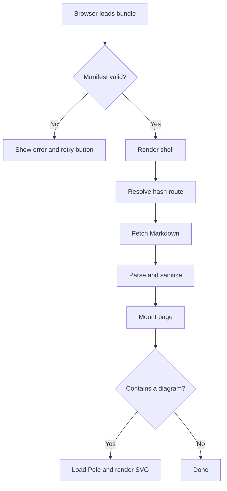
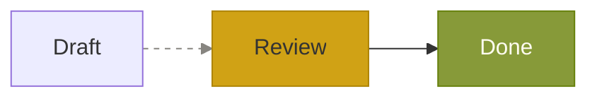
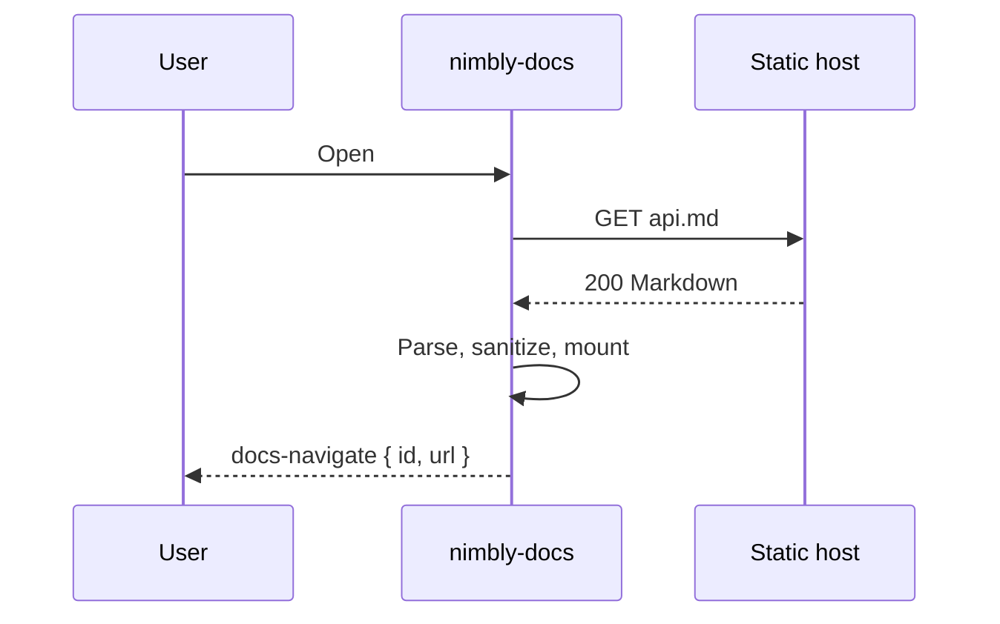
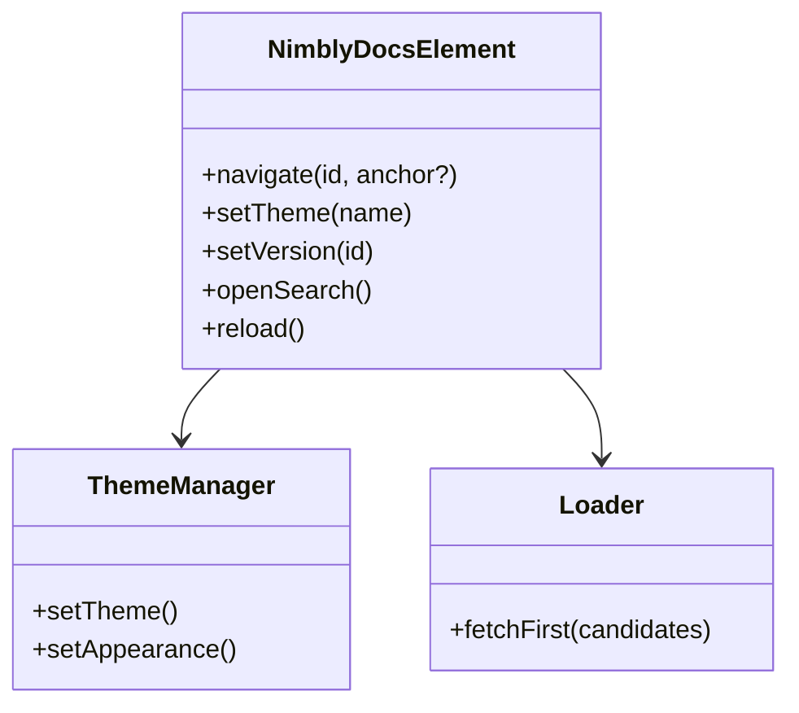
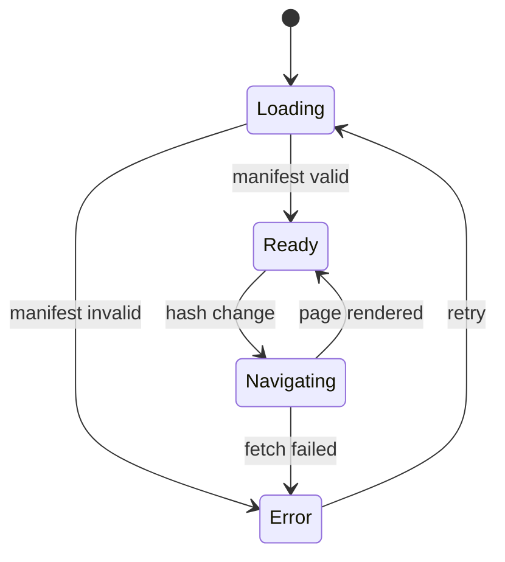
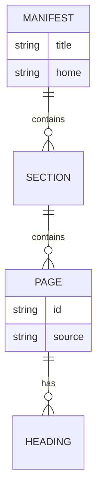
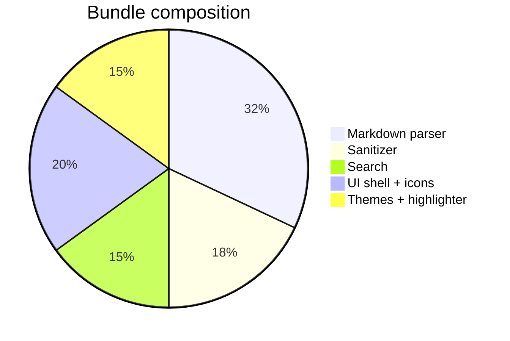
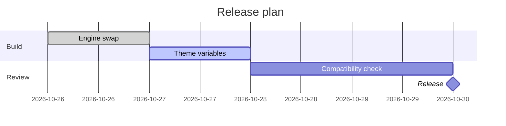

# Diagrams

Write diagrams in [Mermaid syntax](https://mermaid.js.org/syntax/flowchart.html) inside a ` ```mermaid ` code block. Nimbly Docs renders them to SVG with [Pele](https://github.com/obsidianmd/pele), a small renderer for the Mermaid language. Mermaid.js itself is not loaded.

## Enable diagrams

Diagrams are off by default, so the base bundle stays small and has no dependencies. Turn them on with the `mermaid` attribute:

```html
<nimbly-docs manifest="./index.json" mermaid="on"></nimbly-docs>
```

Pele is imported from a pinned CDN URL, and only on pages that contain a diagram. If your Content-Security-Policy does not allow that CDN, host the file yourself and point to it:

```html
<nimbly-docs
  manifest="./index.json"
  mermaid="on"
  mermaid-src="/vendor/pele.js">
</nimbly-docs>
```

Diagram text is treated as data: it cannot run scripts or inject HTML. Colours come from the active theme's CSS variables, so diagrams follow light/dark mode and theme changes without being re-rendered.

If a block fails to parse, it stays on the page as a normal code block.

## Flowchart



You can style nodes and edges with `style`, `classDef` and `linkStyle`:



## Sequence diagram



## Class diagram



## State diagram



## More diagram types :badge[trial]

Pele also handles the types below. Support for them is newer and less tested, so check the output before you rely on them, and report anything that renders wrong.

### Entity relationship



### Pie chart



### Gantt



## Invalid syntax

This block is broken on purpose. It stays visible as code instead of blanking the page:

```mermaid
flowchart TD
    A -->
    this is not valid --> ???
```
