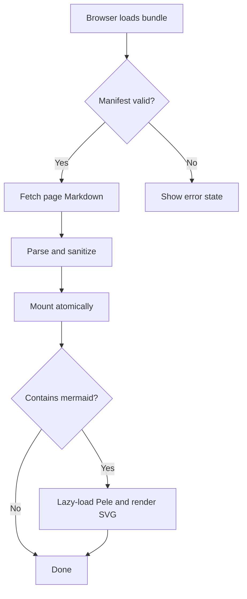
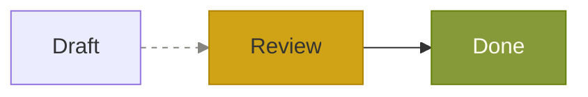
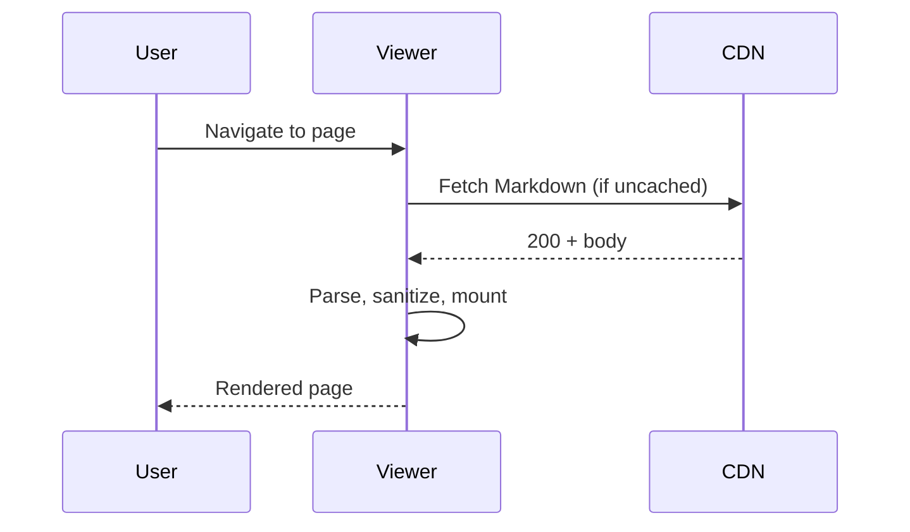
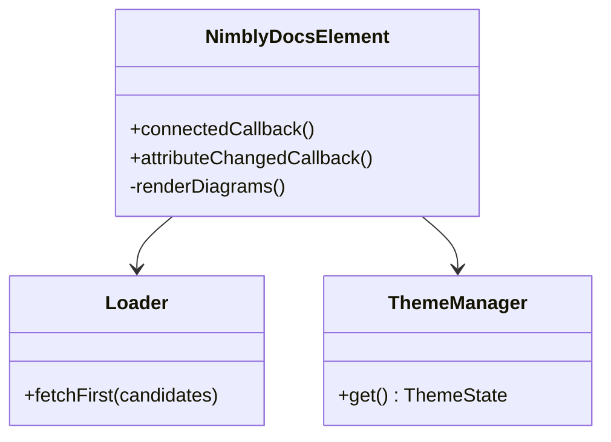
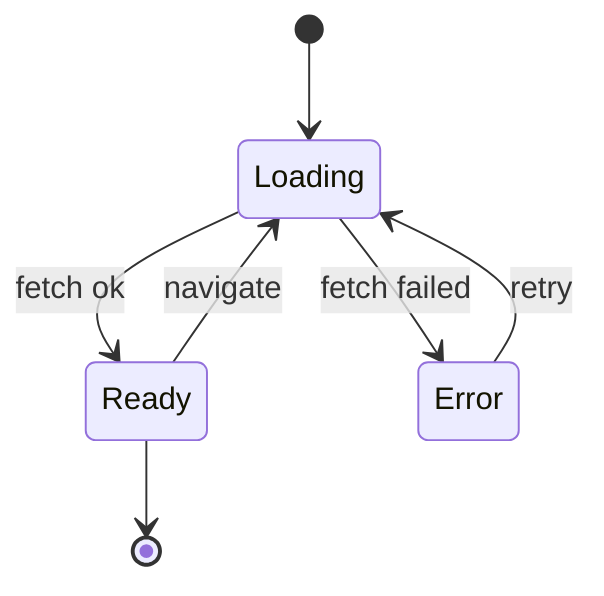
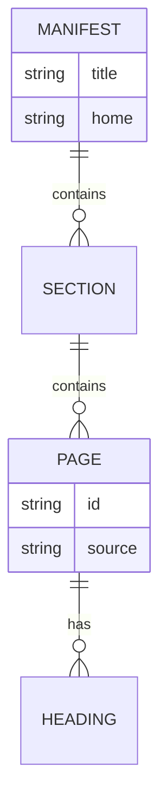
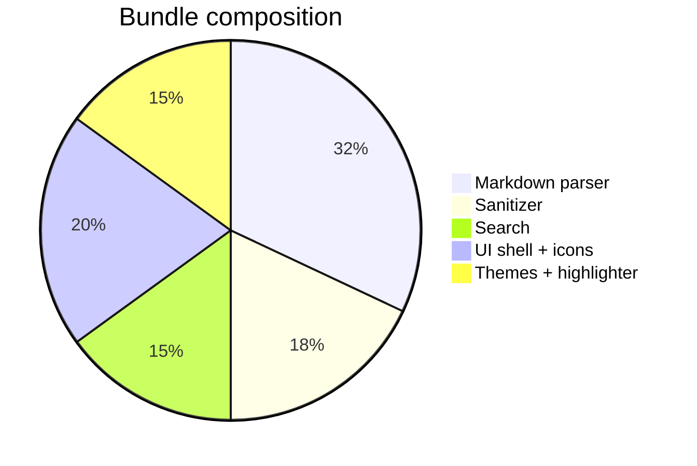
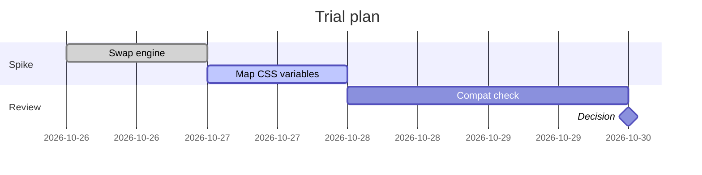

# Pele engine test

This page is a **trial harness** for rendering Mermaid-syntax diagrams with
[Pele](https://github.com/obsidianmd/pele) instead of Mermaid.js. Open it with
`mermaid="on"` and toggle light/dark and each theme in the header: the diagrams
should recolour instantly (Pele reads CSS variables, so there is no re-render).

Each section below is a different diagram type. If any block stays as a plain
code block, Pele could not parse that type — note which one and the version.

## Flowchart



## Flowchart (left-to-right, styled)



## Sequence diagram



## Class diagram



## State diagram



## Entity relationship



## Pie chart (series colours)



## Gantt



## Invalid block (should stay a code block)

The following is deliberately broken syntax. It must **not** blank out the page;
it should remain visible as an escaped code block.

```mermaid
flowchart TD
    A -->
    this is not valid --> ???
```
